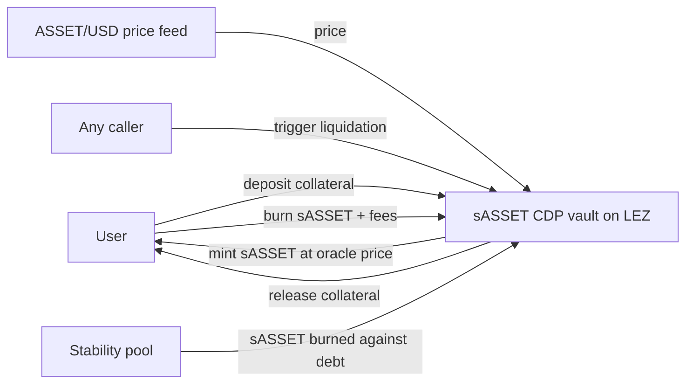

<!-- Don't forget to add this RFP to the table in README.md (between RFP_TABLE_START / RFP_TABLE_END markers) -->

# RFP-024 — CDP-Backed Synthetic Assets (sASSET)

> **Status:** Draft. This RFP is not yet accepting proposal submissions.

> **Note.** This specification describes an outcome that may benefit the Logos
> ecosystem. It is a proposal rather than an instruction. Its requirements
> reflect the technical compatibility with the Logos technology stack and are
> the criteria against which proposals and milestones are evaluated. Logos makes
> no representation as to the legal or regulatory treatment of this
> specification or any implementation of it in any jurisdiction.
>
> Teams implementing it are solely responsible for (i) assessing the risks and
> implications of what they build; (ii) obtaining their own professional advice;
> and (iii) complying with any legal and regulatory requirements that apply to
> them. Software developed under the Program is published and maintained by its
> developers, not by Logos.
>
> Anyone who chooses to deploy, host, operate or use software developed under
> the Program, whether or not they were awarded a grant under the Program, does
> so at their own risk and is solely responsible for complying with any legal or
> regulatory requirements that apply to them. See the
> [Terms & Conditions](../TERMS_AND_CONDITIONS.md).
>
> Deploying the software described in this RFP, operating any service based on
> it, or carrying on business through it may amount to regulated activity in
> some jurisdictions, including where it involves holding or managing users'
> assets or providing services to others. Whoever conducts any such activity
> does so as principal, in their own name, and is solely responsible for
> assessing its regulatory treatment, including any licensing, registration,
> sanctions or anti-money laundering obligations that may apply to them. Logos
> does not make any representation, provide any advice or assume any
> responsibility in respect of any such determination or compliance.

> **Decision-stage draft.** Hard requirements, FURPS detail, team profile,
> timeline and milestones are deliberately omitted; they will be added before
> this RFP opens for submissions.

## 🧭 Overview

This specification describes a CDP-backed synthetic-asset program on LEZ that
mints a synthetic token (sASSET) tracking the price of an oracle-priced asset,
such as `sXMR`, `sZEC`, `sBTC` or `sETH`. Users mint sASSET by locking
collateral from the instance's collateral allow-list into a CDP-style vault,
similar to the Synthetix V3 Pools mechanic (SIP-302), and burn sASSET to recover
their collateral. The program holds none of the tracked asset at any point and
does not interact with the asset's home chain: sASSET is a debt position against
LEZ-side collateral, not a wrapped asset.

The mint, burn and liquidate logic is the same whichever asset is tracked; the
per-asset inputs are the price feed and that synthetic's risk parameters. Adding
a new synthetic (for example `sZEC` alongside `sXMR`) means configuring a price
feed and parameters for it, not changing the vault logic. Synthetix used the
same structure to list `sUSD`, `sETH`, `sBTC`, `sXMR`, `sBCH`, `sADA` and others
off a single CDP-minting engine.

The design follows **Synthetix CDP minting** (SIP-302 Pools V3). A related
deployed example is Synthetix's historical sXMR ERC-20 (Hadar release,
2020-03-30), which was SNX-collateralised, priced via Chainlink and not
redeemable for XMR; it was one of a family of oracle-priced synths off the same
engine. See
[appendix/synthetics-design-space.md](../appendix/synthetics-design-space.md)
§Oracle-priced over-collateralised synthetics.

The program may be independently deployed and configured by those who choose to
deploy it. It is written for the LEZ v0.4 actor model, and the team deploys and
tests it on LEZ testnet 0.4. Redemption of sASSET to the real asset on its home
chain (for example through an atomic-swap extension using RFP-003) is outside
the scope of this RFP and does not change the CDP mint mechanic.

## Target platform: LEZ testnet 0.4 (required)

The program must be written against the LEZ v0.4 actor program model, and the
team deploys and tests it on LEZ testnet 0.4. Until public testnet 0.4 endpoints
are available, development and testing may use the latest v0.4 release candidate
on a local chain (`v0.4.0-rc3`, tagged 2026-11-11, at the date of this
specification); milestone acceptance takes place on LEZ testnet 0.4.

## Comparison with federated and custody-backed designs

Two deployed alternatives for synthetic or wrapped exposure to external assets
differ from this design in what they hold and what users rely on:

- **Federated-signer middle chain (Thorchain/Serai-style).** A purpose-built
  chain whose validator set holds external assets in a threshold-signature
  vault. This supports AMM liquidity and one-step swaps; users rely on the
  signer set not colluding and on the security of the vault software. Deployed
  examples have recorded losses (Thorchain's 2026-05-15 TSS vault drain;
  Wormhole's 2022 bridge loss). For privacy-coin underlyings, threshold custody
  requires view-key sharing, so signers can see deposit history.
- **Custodial bridge or real-asset multisig (sBTC, Secret Monero Bridge).** A
  token backed 1:1 by the real asset held in a federated multisig. Users rely on
  the signer set for custody and for redemption liveness; for XMR the same
  view-key disclosure applies.

In the design described here, the program holds only LEZ-side collateral and
never holds the tracked asset, so there is no signer set, multisig or bridge,
and no view key is shared. The custody-backed designs and their documented
reception are surveyed in
[appendix/synthetics-design-space.md](../appendix/synthetics-design-space.md).

## Which assets fit this design

Any asset with a usable price feed can be configured as a CDP-backed synthetic.
The asset's own chain capabilities do not affect minting, because the vault only
holds LEZ-side collateral. Examples:

- **`sXMR` (Monero).** Monero price exposure on LEZ without holding XMR. Monero
  has no smart contracts and no SPV proof, but a CDP synthetic does not need
  either because the program never interacts with Monero.
- **`sZEC` (Zcash).** Zcash price exposure on LEZ without holding ZEC.
- **`sBTC` (Bitcoin).** Bitcoin price exposure on LEZ without a federation
  holding BTC (contrast Stacks sBTC, which is custody-backed; see the appendix).
- **`sETH` (Ethereum).** Ethereum price exposure; ETH has several independent
  price feeds, which makes it a candidate for testing the engine before assets
  with fewer feeds.

What varies per asset is configuration, not mechanism: price-feed quality and
redundancy, price volatility (which drives the c-ratio and liquidation
parameters), and whether a suitable price feed exists at all. Proposals should
state, for each asset they demonstrate, which price feed they use and how its
manipulation resistance was assessed.

## High-level functionality and flow

- **Mint.** A user deposits collateral from the instance's collateral allow-list
  into the sASSET vault. The program mints sASSET at the current price-feed
  value for the tracked asset, up to the instance's configured minimum c-ratio.
  The user holds sASSET; the vault holds the collateral.
- **Burn / unwind.** The user repays sASSET (plus any configured fees) and the
  vault releases the collateral.
- **Liquidation.** If a position's c-ratio falls below the configured threshold,
  any caller can trigger liquidation. The position's debt is absorbed by the
  stability pool (below) and surplus collateral, less the configured penalty, is
  returned to the position owner.
- **Trading.** sASSET is a fungible token on LEZ and can be traded on any LEZ
  DEX that supports it, such as one implementing RFP-004. Its market price may
  differ from the price feed by whatever spread the market clears.

This RFP contains **no atomic swap and no custody of the tracked asset**. A user
who wants the real asset on its home chain sells sASSET on a DEX and acquires
the asset elsewhere; a redemption extension is outside the scope of this RFP.

## Configuration and roles

The program exposes the following as instance configuration, set when an
instance is initialised and, where the instance allows it, changed through its
admin authority:

- the collateral allow-list and per-collateral concentration caps;
- the list of synthetics, and for each one its price feed, minimum c-ratio,
  liquidation threshold, liquidation penalty and debt ceiling;
- price-deviation and staleness guards;
- any fees (mint, burn, stability or interest) and the account that receives
  them;
- the deployed addresses of the price-feed, collateral-token and sASSET-token
  programs the instance uses;
- the admin and freeze authorities.

No authority holder, fee recipient, price feed or production parameter value is
hardcoded. Proposals provide default parameter values for testnet only and
document how each parameter affects position safety.

## Liquidation mechanism (required)

Proposals must specify the liquidation mechanism explicitly rather than relying
on "standard CDP liquidation". A synthetic that tracks a volatile asset with a
thin secondary market has a failure mode that generic CDP liquidation does not
address:

- A user mints sASSET against collateral. The tracked asset's price rises and
  the position's c-ratio falls below the liquidation threshold.
- A keeper-style liquidator must buy sASSET on the market to repay the debt and
  claim the seized collateral at a discount. If the tracked asset keeps moving
  while the liquidator buys sASSET, the sASSET can cost more than the discount.
- If no liquidator acts, the position's debt can exceed its collateral value,
  leaving bad debt in the system.

In a thin sASSET market, the range in which keeper liquidation is profitable
narrows as the tracked asset moves faster. For this reason the liquidation layer
cannot rely on a generic lending-market design (Aave, Compound and Morpho-style
designs assume the borrowed asset has a deep secondary market the liquidator can
reach in one transaction). Position accounting (isolated CDPs, c-ratios,
price-feed valuation) can be reused; the liquidation absorption mechanism
cannot.

**Required baseline: a Liquity-style stability pool.** Depositors place sASSET
in a pool. When a position falls below the threshold, the program burns sASSET
from the pool against the position's debt in the same transaction and credits
the seized collateral to pool depositors pro rata. Liquidation then does not
depend on secondary-market sASSET depth, and the liquidation trigger is a
function any caller can invoke. Because pool deposits and outstanding sASSET
debt are both recorded on-chain, the instance can cap issuance relative to pool
deposits.

Proposals may describe alternative liquidation absorption mechanisms, but must
explain how the mechanism handles the thin-secondary-market case above.
Liquidation must not depend on any particular operator: any keeper or bot
software supplied is reference software that third parties may choose to run.

## Pros

- **No custody of the tracked asset.** The program never holds the tracked
  asset; the vault holds only LEZ-side collateral. There is no signer set,
  multisig or bridge, and no view key is shared, for every listed synthetic.
- **One engine, many assets.** One CDP program supports a configurable set of
  synthetics. A new synthetic requires a price-feed integration and parameter
  configuration, not a new program. Each instance and each listing still
  requires its own configuration and assessment.
- **Composable.** sASSET is a fungible LEZ token with a documented message
  interface; lending markets, DEXes and other LEZ programs can integrate it
  without coordinating with the synthetics team.
- **No atomic-swap interaction.** Mint and burn are LEZ-native operations, with
  no atomic-swap latency, maker discovery or counterparty interaction.
- **Documented design references.** Existing CDP designs (Synthetix, MakerDAO,
  Liquity) are publicly documented; the work is adapting those patterns to LEZ.

## Cons

- **No path to the real asset within this RFP.** A user who wants the underlying
  on its home chain must sell sASSET at the market price and acquire the asset
  elsewhere. sASSET does not redeem to the underlying.
- **Soft peg only.** The market price of sASSET can differ from the price feed,
  and the gap can widen under stress (price-feed staleness, collateral price
  falls, large unwinds).
- **Shared debt.** In a V2-style debt pool, all synth holders share aggregate
  debt; in V3-style per-pool debt, the same model applies within a pool.
  Proposals must pick a model and document its failure modes. With multiple
  synthetics in one pool, a sharp move in one asset's price affects every
  position in that pool.
- **Price-feed quality varies by asset.** The engine is asset-agnostic but its
  behaviour under manipulation is not: ETH has several independent feeds, while
  a less liquid asset may have fewer feeds and weaker manipulation resistance.
  Each listing depends on the properties of its price feed.
- **Mint, burn and vault state are public.** Position, pool and vault state are
  held in public accounts on LEZ. Users can interact from private accounts, but
  the resulting position changes, timing and amounts are recorded in public
  state and may be correlated.
- **Demand for a non-redeemable synthetic.** Users who want the real asset may
  not be served by a debt position that only tracks its price. Proposals should
  include evidence of demand for the synthetics they demonstrate.

## Risks

- **Price-feed manipulation.** A manipulated ASSET/USD feed lets an attacker
  mint sASSET cheaply or push existing positions below the liquidation
  threshold. Mitigation: support median-of-N pricing across feeds,
  price-deviation guards and staleness checks. The exposure depends on the depth
  of each asset's feed, so proposals document a feed assessment per demonstrated
  asset.
- **Collateral price risk.** If a collateral asset loses its peg or is
  compromised, the collateral backing sASSET loses value. Mitigation: support
  per-collateral concentration caps and liquidation parameters that account for
  collateral volatility, and document the threat model of each collateral asset
  used in testing.
- **Liquidation not executing.** If liquidation depends on profitable keeper
  action, positions can become under-collateralised during fast price moves. On
  LEZ, callers also pay for reverted liquidation attempts. Mitigation: the
  stability-pool mechanism above, a liquidation trigger any caller can invoke,
  and documented fee and MEV considerations.
- **Secondary-market liquidity.** Demand to mint may exist without matching
  secondary-market liquidity for sASSET; tradability depends on LEZ DEX
  liquidity.
- **Privacy expectations (privacy-coin listings).** For `sXMR` and `sZEC`, the
  tracked asset is a privacy coin, but sASSET mint, burn and vault state are
  recorded in public on-chain state. Documentation must state this plainly.

## Out of Scope

- Redemption of sASSET to the real asset on its home chain, including any
  atomic-swap redemption extension.
- Custody of the tracked asset, or any bridge to its home chain.
- Versions of the program for LEZ models earlier than v0.4.
- Mainnet deployment. Mainnet deployment is not part of this RFP: whether, when
  and by whom the software is deployed is a matter for those who deploy it.
- The identity of persons holding the admin and freeze authorities, and the
  exercise of those authorities, including the choice of collateral, synthetics,
  price feeds, fee recipients and parameter values, in any deployment, are
  matters for the relevant independent deployer or operator and are outside the
  scope of this RFP.

## ⚠ Platform Dependencies

The program depends on the capabilities below, with status as at the date of
this specification. Specific RFPs and Lambda Prizes are named only as
illustrative examples; proposals state which implementation they build against
and how they would absorb an interface change.

- **LEZ v0.4 core programs (available).** The native token, clock and fee
  programs are part of the LEZ v0.4 core runtime.
- **Fungible token implementation.** A token implementation on testnet 0.4 for
  sASSET and for test collateral, or the proposal's own; proposals state which.
- **Price feeds.** An ASSET/USD price feed on LEZ testnet 0.4 for each
  demonstrated synthetic, answering the vault's price messages. RFP-019
  (On-Chain TWAP Oracle) and RFP-020 (RedStone Off-Chain Oracle Adaptor) specify
  examples of such feeds. If no v0.4 price feed is available, proposals include
  a test price-feed program for testnet use and say so.
- **Admin and freeze authority.** Bounded admin and freeze capabilities for the
  configuration above. RFP-001 and RFP-002 specify examples.
- **Lending-market position accounting (optional).** Proposals may implement CDP
  position accounting (isolated vaults, c-ratios, price-feed valuation) on top
  of an existing LEZ lending market, such as one implementing RFP-008, instead
  of building it standalone, in the spirit of MakerDAO's Direct Deposit modules.
  This is optional: the synthetic must still work without it, and the
  stability-pool liquidation mechanism above is required whichever approach is
  taken.
- **DEX.** sASSET trading uses any LEZ DEX, such as one implementing RFP-004.
  This is not required for mint, burn or liquidation.

## 🌍 Open Source Requirement

All code must be released under the **MIT+Apache2.0 dual License**.

## Resources

- [RFP-001 — Admin Authority Library](./RFP-001-admin-authority-lib.md)
- [RFP-002 — Freeze Authority Library](./RFP-002-freeze-authority-lib.md)
- [RFP-003 — Atomic Swaps with LEZ](./RFP-003-atomic-swaps.md)
- [RFP-004 — Privacy-Preserving DEX](./RFP-004-privacy-preserving-dex.md)
- [RFP-008 — Lending & Borrowing Protocol](./RFP-008-lending-borrowing-protocol.md)
- [RFP-019 — On-Chain TWAP Oracle](./RFP-019-twap-oracle.md)
- [RFP-020 — RedStone Off-Chain Oracle Adaptor for LEZ](./RFP-020-redstone-oracle-adaptor.md)
- [appendix/synthetics-design-space.md](../appendix/synthetics-design-space.md)
- [Logos Execution Zone repository](https://github.com/logos-blockchain/logos-execution-zone)
  (`dev` branch and `v0.4.0-rc*` tags): the v0.4 actor program model.
- [LEZ actor program development book](https://github.com/logos-blockchain/logos-execution-zone/tree/moudy/guide-mdbook-fixes/docs/actor-program-development-book/src)
  (draft, branch `moudy/guide-mdbook-fixes`; some names lag `dev`).
- [Synthetix SIP-302 (Pools V3)](https://sips.synthetix.io/sips/sip-302)
  (accessed 2026-05-22): CDP-minting reference for the sASSET design.
- [Synthetix blog: Hadar release (sXMR ERC-20 and sibling oracle-priced synths, 2020-03-30)](https://blog.synthetix.io/new-synths-update-for-the-upcoming-hadar-release/)
  (accessed 2026-05-22): historical example of several oracle-priced synths off
  one CDP engine.

The Resources listed above, and any third-party material referred to elsewhere
in this specification, are for informational purposes only and are intended
solely as guidance regarding tools or other artefacts that may be relevant to
preparing a Submission under the Program. They may include, or may refer to,
earlier published specifications, some of which may have received Submissions.
Logos does not endorse or approve, and makes no representation regarding, any
Submission or referenced material. It is ultimately the Applicant’s
responsibility to determine whether, and how, if at all, to use any Resource.
